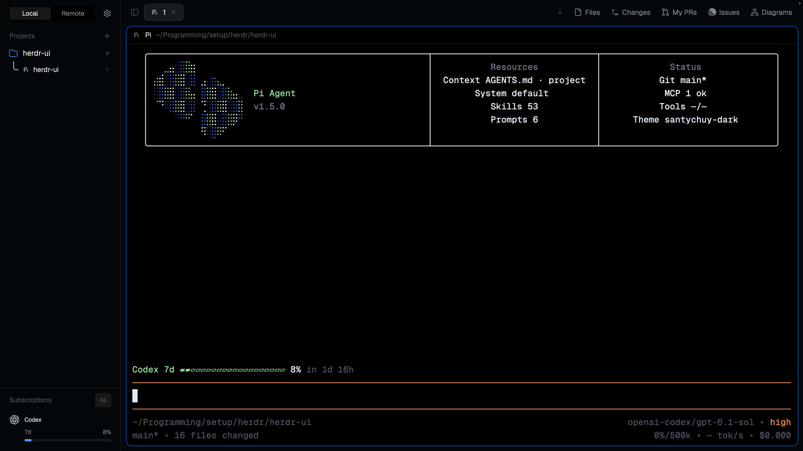

# herdr-ui

Personal layout for [Herdr](https://herdr.dev), with custom mods, keybindings, and themes for everyday agent work.

## What's included

- **Project sidebar** — local and remote projects with live threads, status indicators, and custom icons.
- **Cmd+K switcher** — jump between agents, terminals, projects, and commands.
- **Subscription usage** — provider quotas and reset times in the sidebar.
- **Linear Issues** — browse issues and add an issue prompt to the focused agent's draft.
- **Personal styling** — slim tabs, rounded terminal panes, and Paper / GitHub Dark themes.

This is a separate layout, not a separate app or a replacement for Herdr.

## Use it

See [Setup and syncing](docs/setup.md) for installing on another machine, importing the configuration, and exporting changes back to this repository.

For shortcuts, mod behavior, and implementation details, see [Customization notes](docs/customization.md).
