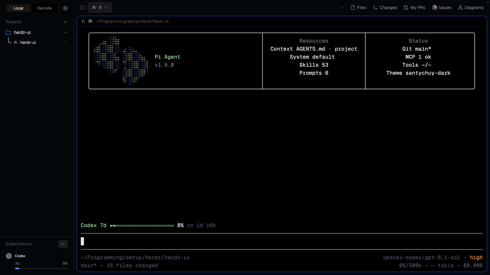

# Santychuy

An agent-work layout with an expandable project/thread tree and subscription usage on the left, slim tabs above rounded terminal cards, an agent-first Cmd+K switcher, and Files, Changes, My PRs, Linear Issues and Mermaid Diagrams on the right. It follows the system appearance with Paper in light mode and GitHub Dark in dark mode. This is a native Herdr layout, not a separate terminal app; the screenshot's Pi terminal interface belongs to the program running inside the pane, not to the layout.



## What you see

All dimensions below are logical pixels before Herdr zoom.

- **Sidebar:** 206px initially, minimum 206px and maximum 480px, theme `chrome`, with a 1px theme `border` separator from the workspace. Its 46px draggable header contains a Local/Remote segmented switch (22px options, 11px text) and a 26px settings button. Reserve native macOS traffic-light space, including at non-default zoom. There is no logo, search button or separate Agents inventory.
- **Projects:** the sidebar's remaining upper area scrolls. Local projects appear directly; Remote groups them by machine. Each project has a neutral 16px folder/gallery glyph or an 18px custom image, title, Git/worktree details, attention count and trailing new-thread +. Standard rows are 28px high; nested worktree rows are 26px. Expanded projects show 28px-minimum thread rows, thin tree connectors and optional Working/Reviewed groups with 25px headers. Titles are about 12px. Rows have no selection/hover background fill: selection uses stronger text and a foreground-colored tree path; unselected branches use the border color at 45% opacity.
- **Subscriptions:** below Projects, requested height 180px, minimum 80px, independently resizable against the project list. A 1px top border and 11.5px dim heading separate it. Compact provider logos, names, quota bars, remaining/reset details, spend summaries and warnings appear inline. Account identities and emails are not displayed. The small All control is disabled.
- **Workspace top bar:** 42px high, theme `canvas`, no bottom border. Leftmost is Show/Hide sidebar. Scrollable tab pills are 29px high, 7px radius, 12.8px text, 14px program icons and titles capped at 170px; the active pill uses `raised` and a 1px border. The right end has new-tab + and Files, Changes, My PRs, Issues and Diagrams buttons. There is no bottom status toolbar.
- **Terminal workspace:** the active tab's native splits, with 8px gaps, 10px card radius, 1px theme border, and a 1px `#1158c7` focused border. Even a lone pane has a frame. Each card has a permanently visible 30px top header: program icon/name, home-shortened working directory, status and hover actions. Header text is 12px; its top corners match the card. The content begins 2px below the top bar, with 8px horizontal and bottom insets. Terminal padding is 10px horizontal and 4px vertical. Transparent terminal default background lets the card paint the rounded corners.
- **Right panel:** initially hidden, requested width 368px, minimum 280px, maximum 900px. One panel fills it at a time. Files/Changes are Herdr's shipped panels; My PRs is an authored-PR list/detail view; Issues is a grouped issue browser; Diagrams is a local themed SVG canvas.
- **Cmd+K:** a 640px-wide popup near the top (40px offset, maximum 85% window height), with 18px inset, search input, view/filter controls, sort control and seven 44px result slots. Agent/terminal results show program icons and project/machine context.

The window has no system title bar; macOS traffic lights are at `[12, 16]`. Bars marked draggable move the window. Native minimize/maximize/close controls appear where Herdr reports they are needed. Fonts inherit the person's settings, otherwise Herdr's bundled fonts. This package's personal settings use zoom 1.2, sounds enabled and minimum terminal contrast 1.

GitHub Dark uses background `#010409`, foreground/cursor `#e6edf3`, selection `#264f78`, and these ANSI colors in order: `#484f58`, `#ff7b72`, `#3fb950`, `#d29922`, `#58a6ff`, `#bc8cff`, `#39c5cf`, `#b1bac4`, `#6e7681`, `#ffa198`, `#56d364`, `#e3b341`, `#79c0ff`, `#d2a8ff`, `#56d4dd`, `#ffffff`. Other panel/status colors are theme-derived, not fixed dark-only colors.

## How it behaves

### Agent states

| State | Projects / thread tree | Top tab / pane header | Cmd+K |
| --- | --- | --- | --- |
| working | Native 900ms spinner in the working color; non-current, unpinned work enters Working | 900ms spinner in working color | Working label |
| blocked | Needs-you indicator in blocked color; errors also count as blocked | Blocked dot on tab; pane badge says Needs you | Needs you, ahead of unread replies in attention order |
| done | Unread-reply dot in ANSI green; remains visible even while children work | Done-color dot; pane dot is 7px | Unread reply |
| idle | Subdued neutral dot; no busy animation | No status decoration | Idle |

Thread status aggregates terminal ancestry: blocked/errors outrank unread parent replies, then working, then idle. Child completion alone does not invent an unread parent reply. Loading/unavailable machines show Unavailable, not idle/done; their entries cannot be opened. Shell and mod-only tabs remain navigable. Reading/focusing finished work lets Herdr clear its unread state. Reviewed is presentation state, not another agent lifecycle state.

### Navigation and controls

- Local/Remote changes the visible scope without changing terminal focus. Selecting a project elsewhere synchronizes that scope and unfolds its machine. Local + explicitly creates a space on this computer; remote machine + creates it there. Machine headers fold; connection failures remain visible. Connect on a replaced machine re-pairs its saved connection.
- Projects start expanded. Hovering a project crossfades its icon into a chevron over 140ms; clicking that icon folds/unfolds only that project without selecting it or starting a drag. Click its title to select. Project + selects that project and opens Herdr's agent/terminal chooser. Right-click opens its menu, including rename, icon customization, Git worktree actions when applicable, and close. Drag projects only within their machine's group. Worktrees nest below their main checkout.
- Click a thread to focus its primary agent, or select its project/tab if it has no primary agent. Current and pinned threads stay above the Working/Reviewed shelves; pins lead the list. Hover tools pin/unpin the primary agent tree or mark quiet finished work Reviewed. Busy/blocked or unavailable work cannot be reviewed. Reviewing puts a tab away without stopping terminals; clicking reviewed work brings it back, and the restore tool clears Reviewed. Expand the subagent count to inspect descendants; clicking one opens a terminal peek. Project/shelf fold choices persist independently.
- Click tab pills to select, double-click to rename, drag between pills to reorder, right-click for the native tab menu; only the active pill shows its close button. Wheel movement over the bar selects the previous/next tab. Reviewed tabs normally leave the bar, but current or newly busy/attention-worthy tabs remain visible. New-tab + opens the chooser; it is not a direct new-shell action.
- Click a pane header to focus that exact pane. Hover reveals split-right, split-down, zoom/unzoom and close, all targeting that pane rather than whichever pane was previously focused. Native pane grips and split boundaries retain Herdr's move/resize behavior. The project/subscriptions divider can resize Accounts; sidebar visibility is native and restores its prior expanded width, with no compact rail.
- Panel buttons select/open their panel; clicking the active one closes it. Each project's panel selection/closed state is remembered independently. Files/Changes buttons respect Herdr's enabled-panel choices; My PRs, Issues and Diagrams remain available.
- Settings opens Herdr settings; an accent dot marks an update ready to install. Custom navigation/chrome/pane/palette hover hints show only an effective shortcut when one exists, not descriptive tooltips. Accessible names retain the descriptions. Shipped panels and integration-specific help retain their own hover behavior.

### Switcher and keys

Cmd+K (also Cmd+Shift+K in this layout) opens Agents every time. Views are Agents, Terminals, Projects, Commands & keys. Agents includes primary/split agents and reporting or recognized subagents, not plain shells. Terminals lists individual pane/background terminals and labeled Mod tab entries. Projects follows sidebar order with assigned icons/colors, thread counts and each project's first live pane folder (falling back to its saved folder, then `~`); it has no status badges, filters or sort control. Search matches titles, programs, native tab names/numbers, addresses, folders and project/machine context; fuzzy title matches outrank context-only matches. Unavailable results cannot open.

In Agents and Terminals, filters cycle All → Needs attention → Working → Idle → Reviewed, and sorting cycles Attention first → Recent activity → Project → Name A–Z. Sort preference persists without affecting Projects. View changes retain the query but reset the filter/selection/scroll. Tab advances views; Shift+Tab advances filters only in Agents and Terminals and does nothing in Projects or Commands & keys. Arrows navigate, Page Up/Down move seven rows, Enter opens/runs and Escape closes. Search keeps keyboard focus. Commands are the available Herdr command catalog, with effective bindings and recent selections; selecting one executes it, not just displays it.

Merge these bindings into an existing installation rather than overwriting the person's keys:

| Keys in Santychuy | Action |
| --- | --- |
| Cmd+B / Cmd+, | Toggle entire sidebar / Settings |
| Cmd+N / Cmd+T | New tab |
| Cmd+Shift+T / Cmd+Shift+W | Rename / close tab |
| Cmd+[ / Cmd+] / Ctrl+Tab / Ctrl+Shift+Tab | Previous/next tab (Shift+Tab reverses Ctrl+Tab) |
| Cmd+1…9 / Ctrl+1…9 | Native selectable tab index / space index |
| Cmd+Shift+S / Cmd+Alt+W | New / close space |
| Cmd+Shift+[ / Cmd+Shift+] | Previous / next space |
| Cmd+/ / Cmd+. | Split pane right / down |
| Cmd+W / Cmd+Shift+Enter | Close / zoom pane |
| Cmd+Alt+H/J/K/L | Focus pane left/down/up/right |
| Cmd+Alt+Shift+arrow | Swap pane in that direction |
| Cmd+Alt+[ / Cmd+Alt+] | Previous / next agent |
| Cmd+Shift+L | Cycle layouts |
| Cmd+plus / Cmd+minus / Cmd+0 | Zoom in / out / reset |

Terminal-specific bindings preserve Cmd+C copy, Cmd+V paste, Ctrl+V paste-image; Alt+Left/Right/Backspace send word movement/deletion; Cmd+Left/Right/Backspace send start/end-of-line/delete-to-start. Normal shell control keys are not claimed. These are macOS-oriented bindings, not a cross-platform remapping scheme.

### Integrations

- **Subscriptions:** discover native Codex (including managed accounts), Claude Code and OpenCode OAuth logins, with matching Pi OAuth as fallback. Merge matching provider identities, preferring usable native readings. Query supported providers and show missing/expired/unavailable data honestly; a saved login does not prove a paid subscription. Refresh every two minutes and on machine changes; immediately clear the previous machine's snapshot and ignore late responses. No details popover, manual-refresh control, or account-email reveal.
- **My PRs:** list up to 30 latest-updated open PRs authored by the GitHub CLI's authenticated user, across repositories. Refresh manually, click to view description, branches, diff counts, review/merge state, checks, latest reviews and comments; Back returns to the list. This is read-only, not a review/merge tool.
- **Issues:** connect a read-only Linear personal API key through a masked field. All means all readable non-archived workspace issues, not just the selected Git project; Assigned to me and team filters narrow it. Load 50 at a time, group by exact workflow status name/category/position, preserve API order inside groups, and fold headers independently. Include Done/Canceled/Duplicate; counts cover loaded results only. Show assignee photos, initials or an unassigned glyph. Refresh is explicit, not background polling. Settings contains connection replacement and confirmed removal of the saved key. Clicking an issue inserts `Let's analyze this linear issue: IDENTIFIER` at the focused available agent's input cursor, without clearing its draft, changing the clipboard or submitting Enter. It rejects shells, blocked/errored agents and unrelated last-viewed agents, and supports remote focused agents.
- **Diagrams:** an empty-state card copies a complete agent prompt, with a brief green check confirmation; copying does not render anything. An agent publishes raw Mermaid from a file through the local renderer. Publishing replaces the current revision and opens the panel; failed renders preserve the previous valid diagram. Full-color SVG follows panel width and theme. Scroll/pan, Shift+scroll horizontally, drag anywhere in the canvas, Ctrl/Cmd+wheel zoom around the pointer (25–400%), −/+/100%, and Fit width are available. Fit width also restores an offscreen canvas. A new revision resets the position; resizing preserves it. Refresh reloads local data. Clear permanently deletes the local diagram store, not original source files elsewhere. Hover the info icon for Powered by Pele; its link opens the renderer's repository.
- **Icons:** right-click a project → Customize icon. The 480×520 dialog opens a searchable 60-icon gallery, seven theme-aware tint swatches and a Custom tab. Gallery selection/tint changes save immediately without closing; Enter chooses the first result, Reset restores the neutral folder, Done/Escape closes. Custom accepts one PNG/SVG by picker/drop/paste, preserving image colors. Cmd/Ctrl+V imports only in Custom; Gallery keeps ordinary search-text paste. Cancel/rejected input leaves the previous icon intact. Remote projects still use this desktop's picker, clipboard and asset store.

## Built from

Build native GPUI JavaScript views (`gpui-kit`, `gpui-base`, `herdr`), not HTML/CSS/DOM or a web view. Start with the installed Herdr guide and generated type definitions for the target version. Put everything in one package root with `RECIPE.md`, `preview.png`, `layouts/santychuy.json`, `mods/`, `themes/github-dark.json`, optional merged `keys.json` and `programs.json`. All custom mod manifests use `place: none`; the layout/overlays decide placement.

The layout node tree is:

```text
root row (canvas, border divider, titlebar none)
├─ sidebar column (206px, min 206, max 480, chrome)
│  ├─ brand block (46px, window_drag): my-workspace-chrome
│  └─ sidebar-lists column (resizable)
│     ├─ spaces block (weight 1, min 150): my-spaces
│     └─ accounts block (180px, min 80): account-usage
└─ work column (resizable false)
   ├─ tabs block (42px, window_drag): my-tabs
   ├─ work-body row (padding [2,8], gap 8)
   │  ├─ main block: tab active, framed panes with my-pane header
   │  └─ panel column (368px, min 280, max 900, hidden)
   │     └─ panel-body stack (active files)
   │        ├─ files block: files [shipped]
   │        ├─ changes block: changes [shipped]
   │        ├─ github-prs block: github-prs
   │        ├─ linear-issues block: linear-issues
   │        └─ diagrams block: diagrams
   └─ work-bottom-inset column (empty, fixed 6px)
```

The sidebar's internal lists alone opt into resizing; `sidebar` and `work` have `resizable: false`. Root theme is `{light: paper, dark: github-dark}`, `terminal_opacity: 0`, `terminal_padding: [10,4]`. The active-tab pane definition supplies all card/header styling above. Do not manufacture saved terminal IDs in the layout.

### Mod responsibilities and APIs

- **my-workspace-chrome:** no custom props. Reads `spaces`, `shared`, `layout`, `settings`, `window`, `updates`, `keys`, `theme`; writes shared `spaces.scope`; runs `app.settings`. Accounts for native unscaled traffic-light coordinates when zoomed.
- **my-spaces:** no custom props. Reads `spaces`, `agents`, `terminals`, `panes`, `machines`, `focused`, `window`, theme and shared state. `threads.js` aggregates live tabs/terminal ancestry; `threads-ui.js` draws/reviews/pins/peeks them. Calls `setAgentOrder` using its thread order. Uses `run` for `space.select/new/move`, `tab.select/settle/unsettle`, `agent.focus`, `terminal.pin/peek`; opens `project-menu`, `project-icons`, shipped `menu` and `new-menu`. Stores scope in shared `spaces.scope`, icon choices in shared `space.icons`, and machine/project/shelf folds locally. Read-only Git inspection uses `exec` with the space's `cwd` and machine (`status --porcelain=v2 --branch`, repository root/common-dir discovery), local `watchFolder`, and a 60-second active/visible fallback. `hc` refreshes machine metadata every 15 seconds; explicit Connect removes/re-adds the replaced saved machine identity.
- **my-tabs:** no custom props. Reads native tabs/panes and current `layout`, `shared`, `settings`, `window`, `keys`, `theme`. Runs `tab.select/rename/move/close/prev/next`, `layout.toggle/select/show/hide` and window commands; opens shipped `menu`/`new-menu`. Keeps per-space panel choices in its localStorage with a bounded pending restore so stale state does not overwrite the new project's choice.
- **my-pane:** receives Herdr's `{pane, terminal}` props and resolves live `panes()` by pane ID. Uses `home` to shorten local cwd, `theme`, `keys`, `shared`, `window`; targets `pane.focus/split/zoom/close` explicitly.
- **my-palette:** overlay props include `overlay` for closing. Uses `InputState`, native focus/key contexts, `nextCommand`, `commands`, `layouts`, `keys` and the live space/agent/terminal/pane/machine model. `navigation.js` builds entries; local `threads.js` matches the sidebar model. Uses `run`, `closeOverlay`, `openOverlay` for command selection and the shipped clone prompt. Register Tab/Shift+Tab actions for both `HerdrPalette` and `HerdrPalette > Input`, consume them and restore input focus. Store sort preference and up to 20 recent command IDs locally.
- **project-menu:** receives `{tab, target, overlay}` (project entry uses `tab: space`, `target: {id}`). Inspects Git through `exec`; dispatches native commands or opens shipped `worktree` / custom `project-icons` overlays. Keeps Up/Down/Enter/Escape navigation.
- **project-icons:** receives `{space, overlay}`, is focusable, uses `InputState`, `nextCommand`, `shared/setShared`, `theme`, `appHome`, `exec`, and `closeOverlay`. `catalog.js` supplies the bundled gallery. Node `import.mjs` validates/copies local assets; `native.jxa` uses macOS AppKit for clipboard/picker. Custom images are immutable SHA-256-named files under `data/project-icons/`; choices are machine-qualified space IDs in `space.icons`.
- **account-usage:** no custom props. Reads its bundled `collect.py` with `readTextFile`, runs that code via `exec('python3', ['-c', code], {on: machine})`, and renders sanitized results. Only code crosses machines; credentials/provider HTTP stay on their owner. Uses a 120-second data timer, live spaces/machines, and theme-tinted logos.
- **github-prs:** no custom props. Calls local `exec('gh', ...)` for `search prs --author @me --state open --sort updated --order desc --limit 30` and `pr view` JSON. Uses native list/markdown detail rendering and `theme`; no GitHub write operations.
- **linear-issues:** no custom props. Uses `appHome`, file handoff helpers, local Python `client.py`, `focused/agents` to target input, and Python `draft.py` plus `hc connect` framed attach. `client.py` implements status/connect/disconnect, team/issue reads and bounded avatar caching. Uses native masked inputs and popovers, `exec`, theme and panel-hide layout commands. Connection remains local even when the active terminal is remote.
- **diagrams:** no custom props. Uses `appHome`, `exec`, `readTextFile`, `watchFolder`, `layout/run`, native size/pointer handlers, `theme` and shared rendering state. Local `render.mjs` actions are `init`, `publish`, `view`, `clear`. Bundle `vendor/pele.mjs` (Pele 1.13.0) and its license; render in a worker with concrete theme colors, no links/images, then publish immutable source/SVG/manifest revisions under `data/diagrams/` with `current.json` pointing at the current one. Width/theme-specific SVGs are local cached derivatives, not exported assets.

Keep a local `bindings.js` copy in my-palette, my-spaces, my-tabs, my-pane and my-workspace-chrome: imports are sandboxed to each mod, so cross-mod relative imports are not portable. Keep the two `threads.js` copies aligned. Shortcut resolution prefers the active layout's bindings over global ones; the project context menu's legacy shortcut labels use global bindings only.

### Shipped dependencies, programs and artwork

Keep Herdr's shipped `files`, `changes`, `workspace-chrome`, `pane`, `menu`, `new-menu`, `prompt`, `confirm` and `worktree` installed, rather than exporting/replacing them. The custom views reuse shipped workspace-chrome SVGs (spinner, connectors, machine and action icons), pane close artwork and program icons, including `icons/grok.svg` and `icons/opencode.svg`.

Python 3 is required on every machine whose subscriptions are shown; Git/core machine access is required for project metadata and remote spaces. Local Linear helpers also require Python 3 and herdr-core `hc`; credentials persist in macOS Keychain (`security`) or Linux Secret Service (`secret-tool`), never a plaintext fallback. My PRs needs local authenticated `gh`. Node.js 20+ runs project-icon imports and the bundled Mermaid renderer; no npm install, browser or network is required to render diagrams. Clipboard/native icon selection uses macOS `osascript`; file-drop imports and the bundled gallery do not depend on AppKit.

Bundle the 60 Hugeicons Free Stroke Rounded SVGs (catalog based on `@hugeicons/core-free-icons@4.4.0`) with `LICENSE.hugeicons`, provider SVGs with their LobeHub MIT notice, the Linear/Simple Icons mark and native action SVGs. The omp program override points to `mods/my-spaces/omp.svg`, uses its original gradient π logo and `tint: false`. Program icons in rows follow each program's tint flag. Preserve Pele's MIT and included Lucide ISC notices. All artwork is local; do not replace it with runtime downloads or colored initial tiles.

## Watch out

- This recipe describes the files, not a second product. There is no historical session search/resume/fork, separate attention inbox, account-details view, subscription All action, GitHub mutation, Linear issue mutation, PR pagination, background Linear polling, or true trackpad-pinch API. Do not invent them. Pi/omp terminal widgets and status lines in the screenshot are not layout-owned.
- Mods are trusted programs. Before installing, disclose: Git and `hc` subprocesses inspect projects/machines; explicit worktree/close/reconnect actions can change the user's workspaces/connections. Icon import reads a selected local file or clipboard and writes app-local assets. The palette can execute any offered app command. Link actions launch the system browser using platform openers. Do not describe the entire package as sandboxed/read-only just because issue/PR API queries are read-only.
- Subscriptions reads native OAuth credential files (Codex, managed CodexBar accounts, Claude, OpenCode, Pi fallback) and sends authenticated usage queries to `chatgpt.com`, `api.anthropic.com`, `opencode.ai`, `cli-chat-proxy.grok.com` and `openrouter.ai` for applicable providers. No CodexBar executable is required. API-key-only entries are excluded. Matching identities merge without sending account names/emails/credentials to the sidebar. Provider access can expire or fail; display that state, never fake quota values.
- Linear sends its personal key only to `https://api.linear.app/graphql`. Keys do not belong in command arguments, shared state, layouts, source or exports. Its masked input uses a brief private, owner-only handoff under `data/linear-issues/credentials`, removed after connection; crash leftovers are cleaned when stale after one hour. Avatar downloads accept only bounded, non-redirected HTTPS from `public.linear.app`, without the key. Disconnect removes the local saved key, not the upstream key; revoke separately in Linear. After an ambiguous draft-delivery error, inspect the draft before retrying to avoid duplicates.
- GitHub network requests/authentication belong to the user's `gh` installation. My PRs displays at most 30 PRs, 40 checks, the latest 10 reviews and 10 comments; descriptions/review/comment previews are bounded to 24,000/3,000/4,000 characters.
- Diagrams reads the explicitly named local Mermaid input and writes only its app-local store. Publishing can invoke `herdr-app` to show it. Sources are limited to 50,000 characters, SVG output to 4,000,000 characters, edges to 5,000, and rendering to 15 seconds. Titles are 1–200 characters. Clear is permanent for the diagram store; never clear automatically before publish. A successful render (`ok`) does not prove the panel opened (`shown`).
- Custom icon input accepts one regular PNG/SVG only: PNG ≤8 MiB, side ≤8192px and ≤16 megapixels; SVG ≤1 MiB, declared side ≤8192px, ≤10,000 elements and ≤64 levels. Reject scripts, external resources, embedded images and unsupported active markup. Never store a path to a movable original instead of copying the validated asset. Cancel/errors preserve the prior choice.
- No fixed maximum thread/agent count is imposed; scroll the lists. The 206px sidebar and five fixed-width panel controls assume a desktop-width window; long titles truncate and the top bar can crowd on narrow windows. Zoom scales all logical sizes; do not double-scale macOS traffic-light reservations. Settled tabs do not advertise incorrect native numbered shortcuts.
- Use live model events for status, not polling; use native `.spin`/`.transition` for motion, never redraw timers. Do not retain a callback's `cx`. Git/machine/account timers are for data, not animation. Test later async/interactive states in the app: `herdr-app check` only renders initial eager content.
- The app reads `~/.config/herdr-app`, not this repository. Never set `HERDR_APP_HOME` to the shareable clone. Generated guides/type files and shipped mods/layouts belong to Herdr. Installing into an occupied home must rename collisions and rewrite every mod/asset/key reference instead of overwriting. Merge keys/program overrides; this repo's bulk import script intentionally replaces matching personal config and is not collision-safe gallery installation.
- Do not export provider/Linear/GitHub credentials, shared state, imported icons, generated diagrams, screenshots of private issue/PR content, or terminal session data. The supplied preview is a real expanded-layout frame; current window/panel visibility and provider readings are local state, not guaranteed fresh-install content.

## Done when

- Each of the eleven custom mods passes `herdr-app check <mod folder>` on the target Herdr version. The package contains every custom mod/asset/helper referenced above, the theme, recipe and `preview.png`; no personal credentials/state are required to load it.
- Switching to `santychuy` shows the specified project/subscriptions sidebar, tab bar, framed active-tab panes and hidden right panel. Status reports no file/mod errors. Inspect an actual `herdr-app shot`; initial eager checks alone do not prove the interface renders.
- Sidebar toggle works with the sidebar hidden, preserves its expanded width, and never strands the user without a restore control. The Accounts boundary resizes independently. Light/dark themes and zoom retain readable controls and unobstructed native window buttons.
- With real working/blocked/done/idle agents, the tree, pills, headers and switcher reflect their actual state; unread parent replies survive child work and unavailable machines never appear completed. Clicking a row focuses the right local/remote terminal. Review/pin/fold do not kill a terminal or steal focus.
- Cmd+K opens Agents; Tab changes views, Shift+Tab changes filters only in Agents/Terminals, typing retains focus, Enter opens the exact selected target and Escape closes. Projects retains sidebar order/icons/live folders without agent-status controls. Plain shells appear only in Terminals, mod-only tabs remain accessible, and native tab numbering matches the displayed shortcut hints.
- Project icon selection/tint persists; a valid imported file keeps working after its source is moved. Rejected/multiple-file imports and canceled pickers preserve the previous icon. Project reordering cannot cross machines.
- Files/Changes/My PRs/Issues/Diagrams open in the same right panel and remember per-project choice. With authenticated `gh`, PR list/details load; without it, show an honest error. Subscriptions follows the selected machine without a flash of another machine's account data.
- With a read-only Linear key, paging/filtering/status grouping works and an issue click inserts the identifier prompt into the correct available agent's existing draft without submitting it. Blocked/shell targets are rejected; no issue is changed upstream.
- Publishing a valid local `.mmd` through `node "$HOME/.config/herdr-app/mods/diagrams/render.mjs" publish --file /absolute/path/example.mmd --title "Example"` reports `ok` and `shown`, and an inspected shot shows the diagram. Pan/zoom/Fit width work; invalid Mermaid leaves the last valid revision intact; explicit Clear empties only the diagram store.
- Publish this complete package in a public GitHub repository with topic `herdr-layout`. Herdr documents discovery within an hour; community previews are screened, so pushing alone does not prove the gallery card is already visible.
